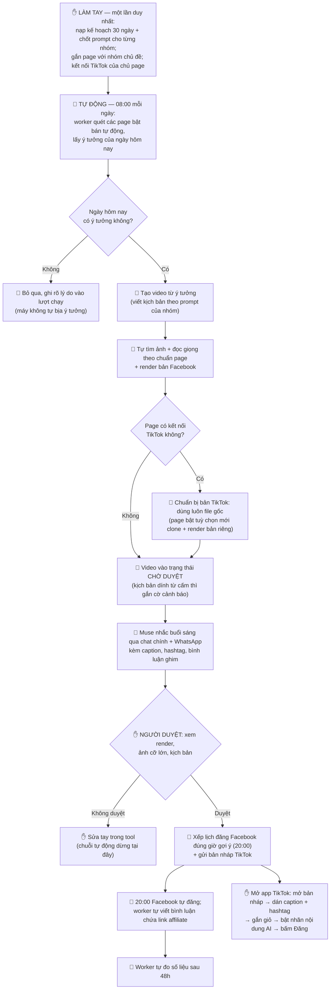

# Brief Reels Studio — Bán tự động dựng & đăng video hằng ngày cho 2 page

> BẢN VIẾT LẠI sau khi review, tối 08/11/2026 — thay toàn bộ bản đầu
> trong chính file này. Hướng đã chốt: bán tự động (máy dựng sẵn,
> người duyệt, máy đăng theo khung giờ) cho 2 page của user: Ăn Lành
> Sống Khỏe và Già Mà Khỏe.
> Trạng thái: USER ĐÃ DUYỆT GỬI CLAUDE CODE (tối 08/11/2026). Ba
> điểm ở mục 11 chưa có ý kiến khác — thi công theo mặc định đã ghi
> trong brief (giờ chuẩn bị 08:00; màn duyệt ở dải "Hôm nay" của tab
> Kế hoạch; "Không duyệt" thì sửa tay). Khi thi công vẫn theo lệ team: đọc AGENTS.md +
> docs/decisions.md, nhánh riêng, TDD, test bằng fake services, báo
> cáo 3 phần, không tự merge.
> Sơ đồ vận hành — bước nào máy làm, bước nào người làm: mục 12 ở
> cuối brief.

## 1. Có phải sửa code không?

**Có** — nhưng chỉ ở phần nối chuỗi. Các khâu lẻ đã có sẵn (mục 2);
phải viết mới đúng 3 thứ:

1. **Bộ điều phối theo ngày** — tự lấy ý tưởng hôm nay của từng page
   trong kế hoạch và chạy hết chuỗi dựng video.
2. **Cổng duyệt** — trạng thái "Chờ duyệt" và hành động Duyệt /
   Không duyệt trong chuỗi tự động.
3. **Khâu nối sau duyệt** — duyệt xong thì tự xếp lịch đăng Facebook
   đúng giờ của page và tự gửi bản nháp TikTok.

Không sửa gì ở phía Facebook/TikTok, không sửa các luồng thủ công.

## 2. Bối cảnh — những gì ĐÃ CÓ trong tool (đã kiểm chứng trong code)

- Mỗi page gắn với một nhóm chủ đề riêng ("Ăn Lành Sống Khỏe – Sức
  khỏe", "Già Mà Khỏe – Dưỡng sinh sau 50") có prompt viết kịch bản,
  từ cấm và kế hoạch 30 ngày riêng. Đó là "tài liệu của từng page" mà
  chuỗi tự động chạy theo.
- Kế hoạch đã tính sẵn cho mỗi ý tưởng: ngày đăng và "giờ đăng gợi ý"
  theo giờ đăng của nhóm.
- Luồng "Tạo video" từ một ý tưởng kế hoạch đã có; sau kịch bản, các
  job tự tìm ảnh stock, đọc giọng, render đều có sẵn trong worker.
- Đăng Facebook có hẹn giờ; **sau khi đăng, worker TỰ viết bình luận
  chứa link affiliate** của các sản phẩm đã gắn vào video (đổi sản
  phẩm thì sửa bình luận cũ). Riêng thao tác ghim bình luận thì API
  Facebook không làm được — và user chốt **không cần ghim**: bình
  luận link tự viết là đủ (tối 08/11).
- Gửi nháp TikTok qua API đã có, qua kết nối TikTok của chính chủ
  page. **Mặc định dùng luôn file render của bản Facebook** — file
  sạch do tool tự render, không mang watermark của nền tảng nào.
  (Luật cứng của team nằm ở chỗ khác: hai page Facebook không bao
  giờ dùng chung một file, và không đăng lại file tải từ nền tảng
  khác / file có watermark.) Tool đã có sẵn đường nhân bản (clone)
  viết lại cho TikTok — đó là **tuỳ chọn tối ưu theo từng page,
  mặc định TẮT ở giai đoạn 1**; chỉ bật khi TikTok thành kênh chính
  hoặc số liệu cho thấy cần bản riêng (chốt của user, tối 08/11).
- Worker đã có mẫu "quét việc đến hạn giữa các job" (cơ chế đo số
  liệu `measure_due`) — bộ điều phối đi theo đúng mẫu này.

## 3. Điều kiện trước khi một page chạy được (kiểm tra ở mỗi lượt)

- Nhóm chủ đề của page đã có prompt viết kịch bản (nhóm chưa có
  prompt thì bỏ qua page đó hôm nay, ghi rõ lý do).
- **Kế hoạch có ý tưởng cho ngày hôm nay.** Ngày trống → bỏ qua,
  không tự bịa ý tưởng, và ghi "hôm nay chưa có ý tưởng trong kế
  hoạch" vào bản ghi lượt chạy để người dùng thấy. (Thực tế hiện
  tại: kế hoạch của nhóm Ăn Lành đang trống 0/0 — phải nạp kế hoạch
  trước thì chuỗi mới có cái để chạy.)
- Page có chủ sở hữu rõ ràng, token đang hoạt động. Đợt này chỉ bật
  cho 2 page của user; page của thành viên khác không chạy.
- Riêng bước TikTok: chỉ làm nếu page có kết nối TikTok của chính
  chủ page. Chưa có kết nối → bỏ qua bước TikTok, ghi rõ trong lượt
  chạy, phần Facebook vẫn chạy bình thường.

## 4. Chuỗi chuẩn bị (mỗi page, mỗi ngày)

Tới "giờ chuẩn bị" của page (mặc định 08:00, chỉnh được), worker quét
và với mỗi ý tưởng của ngày hôm nay:

1. Chưa có video → tạo video từ ý tưởng, chạy job viết kịch bản bằng
   prompt của nhóm. Đã có video thì dùng video đó, không tạo lại.
2. Chạy tiếp các khâu có sẵn: ảnh → giọng → render bản Facebook.
   Giọng và tùy chọn render lấy theo mặc định đang áp cho page/nhóm
   (chuẩn đã khóa: Ăn Lành — ElevenLabs Chi; Già Mà Khỏe — VieNeu
   Huyền My), nhạc theo cơ chế hiện hành của video.
3. Nếu page có kết nối TikTok: chuẩn bị bản TikTok — mặc định chính
   là file render ở bước 2; riêng page nào bật tuỳ chọn "bản TikTok
   riêng" thì mới tạo bản TikTok bằng đường clone viết lại cho
   TikTok và render bản đó.
4. Xong → video vào trạng thái **"Chờ duyệt"**.

Chạy lại trong cùng ngày không tạo trùng (khóa theo ý tưởng + ngày).
Video đã có lượt đăng Facebook hẹn giờ hoặc đã đăng thì bỏ qua toàn
bộ. Khâu nào lỗi (kịch bản lỗi, render lỗi, hết lượt AI…) thì dừng
riêng video đó ở trạng thái lỗi kèm lý do rõ ràng — không cố đăng.

## 5. Cổng duyệt

Màn duyệt (vị trí chốt ở mục 11) cho xem đủ trước khi quyết: bản
render (kèm bản TikTok riêng nếu page bật tuỳ chọn đó), ảnh từng
cảnh, kịch
bản, giọng và nhạc đang dùng, **cờ cảnh báo nếu kịch bản dính từ
cấm**, và các sản phẩm gợi ý gắn kèm (link sẽ vào bình luận do worker
tự viết sau khi đăng; không yêu cầu ghim — user chốt bỏ bước ghim).

- **Duyệt** → tạo lượt đăng Facebook hẹn đúng giờ đăng gợi ý của ý
  tưởng + gửi bản nháp TikTok (nếu có bản TikTok). Có lựa chọn "bỏ
  qua TikTok" cho riêng video này ngay tại màn duyệt.
- **Không duyệt** → không đăng gì cả, video để lại sửa tay. Đợt này
  không làm "dựng lại tự động".

## 6. Điều kiện an toàn (bắt buộc)

- **Không bao giờ tự đăng Facebook khi chưa được duyệt** trong đợt
  này. Bỏ cổng duyệt là nấc sau, brief riêng, chỉ xét sau khoảng một
  tuần duyệt mà không phải sửa gì.
- Số video dựng mỗi ngày của một page không vượt quá số ý/ngày trong
  kế hoạch của nhóm.
- Chỉ người dùng là chủ page mới duyệt được video của page mình.

## 7. Sau khi hai bên được duyệt — chuỗi tự nâng cấp, không làm lại

- **Shopee cấp Open API** (user nhập AppID/Secret vào Cài đặt › Tài
  khoản affiliate trong app): code đã có sẵn — tool tự tạo short link
  kèm subId theo từng video/page cho sản phẩm ĐÃ GẮN vào video; gợi ý
  sản phẩm và báo cáo đơn chạy bằng API chính thức. Phần vẫn qua
  người là CHỌN sản phẩm nào gắn (AI gợi ý, duyệt ở cổng duyệt). Link
  Shopee chỉ nằm trong bình luận Facebook, không gắn lên TikTok.
- **App TikTok được duyệt**: khâu cuối chuyển từ "gửi nháp" sang
  "đăng thẳng công khai" — đường đăng thẳng đã có sẵn trong code,
  caption + hashtag đi kèm video luôn, không cần dán tay. Đây là
  thay đổi nhỏ ở khâu cuối, không phải viết lại chuỗi. Nhưng **gắn
  giỏ TikTok Shop vẫn không qua API được** — vẫn làm tay trong app,
  và còn phụ thuộc tài khoản đủ điều kiện affiliate (vụ nút "Thêm
  liên kết" bị mờ ở @anlanhsk chưa chẩn đoán xong — không hứa trước
  phần giỏ).

## 8. Ngoài phạm vi

- Đăng thẳng TikTok và tự bỏ qua cổng duyệt (xem mục 6, 7).
- Gắn giỏ TikTok. Ghim bình luận: API Facebook không ghim được, và
  user chốt không cần ghim — bình luận link tự viết là đủ.
- Thông báo trong app: lời nhắc phía Muse (đang chạy: nhắc sáng qua
  chat chính + WhatsApp kèm caption/hashtag/bình luận ghim để duyệt;
  nhắc tối ~19:19 gửi riêng khối dán TikTok) đọc trạng thái chờ duyệt
  qua MCP là đủ.

## 9. Gợi ý kỹ thuật (Claude Code chốt chi tiết khi thi công)

- Loại công việc mới cho lượt chuẩn bị (ví dụ `auto_prepare`) + bản
  ghi lượt chạy theo ngày: page, ý tưởng, video, bản TikTok (nếu
  có), trạng thái (đang dựng / chờ duyệt / đã duyệt / không duyệt /
  lỗi / bỏ qua kèm lý do). Đặt cạnh cơ chế job hiện có, không xây
  scheduler riêng; lượt quét theo giờ chuẩn bị đi theo mẫu
  `measure_due`.
- Duyệt / Không duyệt là endpoint mới trên lượt chạy; Duyệt dùng lại
  đúng đường tạo Publication hẹn giờ và đường gửi nháp TikTok hiện
  có; bản TikTok riêng (khi page bật tuỳ chọn) dùng lại đúng đường
  clone hiện có.

## 10. Nghiệm thu

Với fake services và một page thử ở local:

1. Tới giờ chuẩn bị → tự tạo video từ ý tưởng hôm nay, render xong
   hiện "Chờ duyệt"; quét lại lần 2 không tạo trùng. Ngày không có
   ý tưởng → không tạo gì, lượt chạy ghi rõ lý do.
2. Page có kết nối TikTok → lượt chờ duyệt sẵn sàng gửi nháp bằng
   file gốc (hoặc bản TikTok riêng nếu page bật tuỳ chọn); page chưa
   có kết nối → lượt chạy ghi "bỏ qua TikTok", Facebook vẫn
   duyệt/đăng bình thường.
3. Bấm Duyệt → có Publication hẹn đúng giờ đăng gợi ý + nháp TikTok
   được gửi; chọn "bỏ qua TikTok" thì chỉ đăng Facebook. Bấm Không
   duyệt → không có lượt đăng nào.
4. Ép lỗi render → trạng thái lỗi rõ ràng, không đăng. Kịch bản dính
   từ cấm → vẫn vào chờ duyệt nhưng cờ cảnh báo nổi bật.
5. Toàn bộ test api xanh; test web cho màn duyệt xanh; ghi quyết
   định vào docs/decisions.md.

## 11. Ba điểm cần user chốt khi duyệt bản viết lại này

1. **Giờ chuẩn bị mặc định 08:00** — máy dựng buổi sáng để kịp duyệt,
   tối 20:00 đăng; khớp giờ nhắc sáng đã đặt. Ổn hay sớm/muộn hơn?
2. **Màn duyệt đặt ở đâu** — dải "Hôm nay" của tab Kế hoạch (đang
   được làm lại ở brief plan-tab-redesign; em nghiêng phương án này)
   hay danh sách "Chờ duyệt" riêng ở trang Video? Nếu anh không ý
   kiến, brief chốt: dải "Hôm nay" của tab Kế hoạch.
3. **Sau "Không duyệt"** — đợt này sửa tay hoàn toàn, đúng không?

## 12. Sơ đồ vận hành — bước nào máy làm, bước nào người làm

Ký hiệu: 🤖 = TỰ ĐỘNG (tool hoặc Muse làm, không cần người) ·
✋ = LÀM TAY (người làm).

Bảng thao tác theo thứ tự:

| # | Bước | Ai làm | Thời gian | Ghi chú |
|---|------|--------|-----------|---------|
| 0 | Nạp kế hoạch 30 ngày, chốt prompt từng nhóm, gắn page–nhóm, kết nối TikTok | ✋ Tay | Một lần duy nhất | Làm trước ngày chạy đầu tiên |
| 1 | Quét page, lấy ý tưởng hôm nay (trống thì bỏ qua, ghi lý do) | 🤖 Tool | **08:00** | Giờ chuẩn bị, chỉnh được theo page |
| 2 | Viết kịch bản + tìm ảnh + đọc giọng + render bản Facebook | 🤖 Tool | ~08:00–08:30 | Ngay sau bước 1; lâu hay nhanh tùy hàng đợi render |
| 3 | Chuẩn bị bản TikTok (mặc định dùng luôn file gốc; tuỳ chọn mới clone bản riêng) | 🤖 Tool | Cùng lượt bước 2 | Chỉ khi page có kết nối TikTok; bật clone thì cộng thêm thời gian render |
| 4 | Đánh dấu "Chờ duyệt" (+ cờ cảnh báo từ cấm nếu dính) | 🤖 Tool | Ngay khi render xong | Trong buổi sáng |
| 5 | Gửi lời nhắc kèm caption, hashtag, bình luận ghim | 🤖 Muse | ~08:19 | Chat chính + WhatsApp, theo lịch nhắc đã đặt |
| 6 | Xem render, ảnh cỡ lớn, kịch bản → Duyệt / Không duyệt / bỏ qua TikTok | ✋ Tay | Buổi sáng–trưa, **trước 20:00** | Cổng quyết định — không duyệt thì dừng, sửa tay |
| 7 | Xếp lịch đăng Facebook 20:00 + gửi nháp TikTok | 🤖 Tool | Ngay khi bấm Duyệt | |
| 8 | Đăng Facebook + tự viết bình luận link affiliate | 🤖 Tool | **20:00** | Khung giờ đăng của giai đoạn 1; bình luận link tự xuất hiện sau đó ~2 phút — user chốt không cần ghim |
| 9 | Mở nháp TikTok: dán caption + hashtag, gắn giỏ, bật nhãn AI, bấm Đăng | ✋ Tay | Tối, cùng khung ~20:00 | Nháp đã nằm sẵn trong app TikTok từ bước 7 |
| 10 | Đo số liệu 48h | 🤖 Tool | 20:00 hai ngày sau | Đúng mốc 48 giờ sau khi đăng, tự chạy |

Lưu ý số lượng: sơ đồ vẽ theo 1 ý tưởng cho dễ đọc; số clip mỗi
ngày của một page bằng đúng số ý tưởng của ngày đó trong kế hoạch.
Giai đoạn 1 đang chốt 1 clip/page/ngày — hai page là 2 clip/ngày.
Muốn tăng lên 2 clip/ngày chỉ cần nạp kế hoạch 2 ý/ngày và thêm một
giờ đăng gợi ý thứ hai; chuỗi này không phải sửa gì.

Tóm lại phần người phải làm mỗi ngày chỉ còn 2 việc: **duyệt video**
(bước 6) và **đăng TikTok từ bản nháp** (bước 9). Sau này app
TikTok được duyệt thì bước 9 rút xuống còn gắn giỏ bằng tay, phần
đăng do máy làm (mục 7).

---

## Bổ sung tối 08/11 — 3 việc gộp vào cùng brief này

User chốt gộp thêm 3 việc sau vào cùng đợt thi công (vẫn theo lệ:
nhánh riêng, TDD, test bằng fake services, báo cáo 3 phần, không tự
merge; tách PR riêng cho từng việc nếu thấy gọn hơn).

### Bổ sung 1 — Giọng mặc định theo nhóm chủ đề

Hiện trạng (kiểm chứng tối 08/11): giọng đọc chỉ có ở hai tầng —
mặc định của người dùng/nhóm (trang Cài đặt › Thiết lập mặc định)
và thiết lập riêng của từng video. Nhóm chủ đề (KnowledgeTopic)
không có trường giọng. Hệ quả thực tế: 2 page của user dùng 2 giọng
chuẩn khác nhau (Ăn Lành — ElevenLabs Chi; Già Mà Khỏe — VieNeu
Huyền My) nhưng một tài khoản chỉ chứa được một giọng mặc định.

Việc cần làm:

- Thêm giọng mặc định cho nhóm chủ đề: cột mới trên KnowledgeTopic
  (kèm migration), chọn giọng ngay tại trang Kho kiến thức của
  nhóm, cạnh phần prompt và từ cấm; dùng lại đúng bộ chọn giọng của
  trang Thiết lập mặc định.
- Khi tạo video thuộc một nhóm, `options.voice_id` khởi tạo từ
  giọng của nhóm nếu nhóm đã đặt. Thứ tự ưu tiên: giọng đặt riêng
  trên video › giọng của nhóm › mặc định người dùng › mặc định
  nhóm. Video nhân bản giữ giọng của video gốc như hiện tại.
- Áp cho mọi đường tạo video theo nhóm, gồm tạo từ ý tưởng kế
  hoạch; đường MCP tạo video cũng phải tôn trọng giọng của nhóm
  khi video chưa được đặt giọng riêng.

Ngoài phạm vi: không đổi cơ chế TTS; không làm fallback tự chuyển
sang nhà giọng khác khi hết lượt (đã kiểm chứng `tts.py` rẽ nhánh
cứng theo giọng đã chọn — hết lượt VieNeu thì job báo lỗi "thử lại
sau 0 giờ" và dừng video đó; giữ nguyên hành vi này).

Nghiệm thu: nhóm đã đặt giọng → video tạo mới trong nhóm mang đúng
giọng đó mà không cần đặt tay; đổi giọng trên video → render dùng
giọng của video; nhóm chưa đặt giọng → hành vi như hiện tại; test
api + web xanh.

### Bổ sung 2 — Kho kiến thức: thêm số liệu của video + chuyển chế độ hiển thị Bảng / Danh sách

Hiện trạng (kiểm chứng tối 08/11): tab Video của một nhóm
(`TopicVideos.tsx`) là bảng lấy từ `GET /videos?knowledge_topic_id=`,
cột hiện có: ảnh nhỏ, tiêu đề/chủ đề, loại, trạng thái, nền tảng đã
đăng, người tạo + ngày tạo. Payload chưa có số view nào, dù số liệu
đã có sẵn trong `PostMetrics` (hai mốc "latest" và "48h" theo từng
Publication; tab Kế hoạch đã có mẫu tính `posts[]` cho ý tưởng).

Việc cần làm:

- API danh sách video bổ sung số liệu đăng của từng video: view
  mới nhất, view 48h, lượt share và tỉ lệ share/view (khi đã có số
  đo), tổng hợp từ các Publication của video. Video chưa đăng thì
  để trống — không hiện số 0 giả.
- Tab Video của nhóm hiển thị thêm các cột số này.
- Thêm nút chuyển chế độ hiển thị **Bảng | Danh sách** ở tab Video:
  dạng Bảng là bảng hiện tại; dạng Danh sách là các thẻ dọc (ảnh
  lớn hơn, tiêu đề, trạng thái và các số liệu chính). Nhớ lựa chọn
  của người dùng (localStorage là đủ). Chuyển chế độ không làm mất
  ô tìm kiếm và bộ lọc trạng thái đang chọn.
- Tab Kế hoạch: thẻ ý tưởng đã gắn video hiển thị thêm số view mới
  nhất của video đó, cạnh dòng số 48h hiện có.

Nghiệm thu: video đã đăng hiện số view khớp với mục Bài đăng;
video chưa đăng không lỗi và không hiện số giả; chuyển qua lại
Bảng/Danh sách giữ nguyên kết quả lọc.

### Bổ sung 3 — Tab Kế hoạch 30 ngày: bấm vào ngày thì mở drawer

Hiện trạng (theo ảnh user gửi tối 08/11): ở chế độ "Gọn", bấm vào
một ngày thì các thẻ ý tưởng xổ xuống ngay bên dưới thẻ ngày, đẩy
nội dung xuống và mất ngữ cảnh khi kế hoạch dài.

Việc cần làm:

- Bấm vào một ngày (tiêu đề ngày hoặc thẻ ngày) → mở **Drawer**
  chứa toàn bộ thẻ ý tưởng của ngày đó, với đầy đủ thao tác hiện
  có trên thẻ: Mở video / Tạo video, Sửa, chuyển về Backlog, xoá.
  Tiêu đề drawer dạng "Ngày N — Thứ …, dd/mm" tính theo ngày bắt
  đầu của kế hoạch.
- Bỏ kiểu xổ inline hiện tại ở chế độ "Gọn". Chế độ "Đầy đủ" giữ
  nguyên như hiện tại.
- Đóng drawer không làm mất vị trí cuộn của trang và không reset
  bộ lọc đang chọn.

Nghiệm thu: bấm ngày → drawer mở đúng ý tưởng của ngày đó; sửa ý
tưởng ngay trong drawer lưu được và thẻ ngày cập nhật số lượng/
trạng thái; test web xanh.
